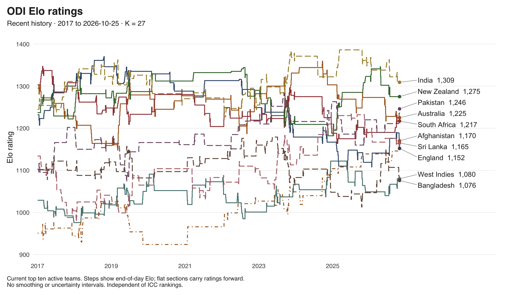
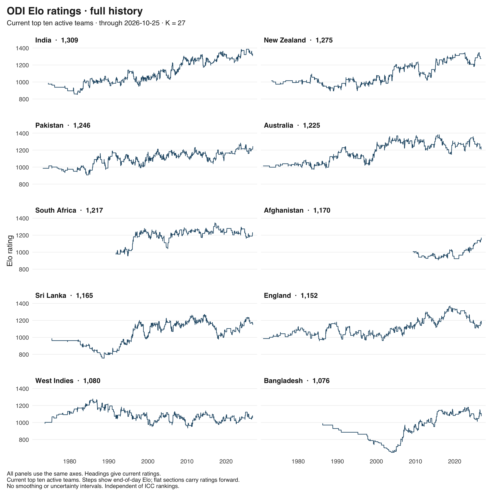
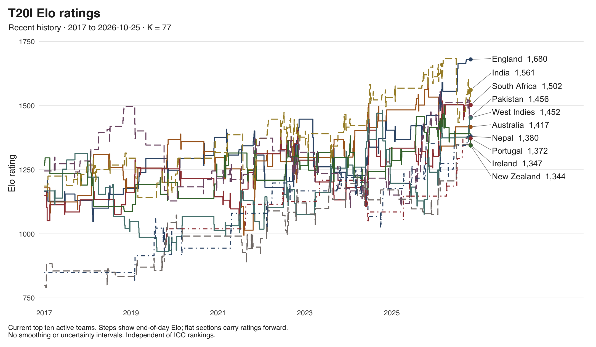
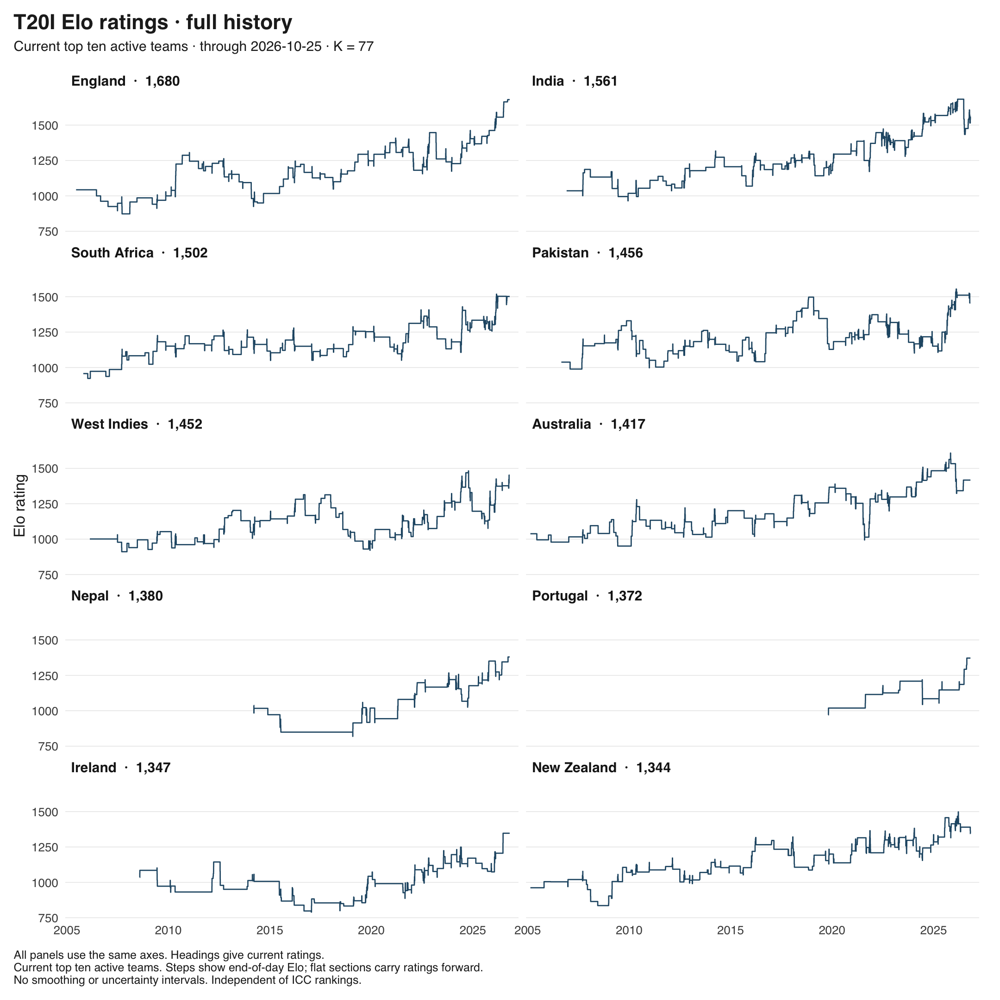
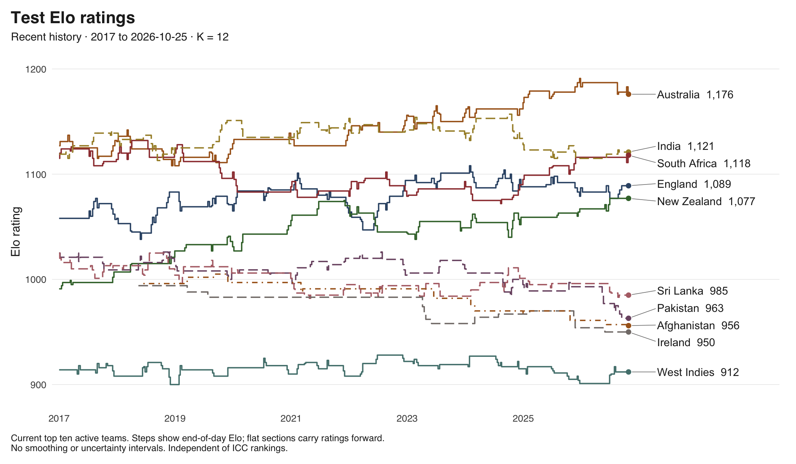
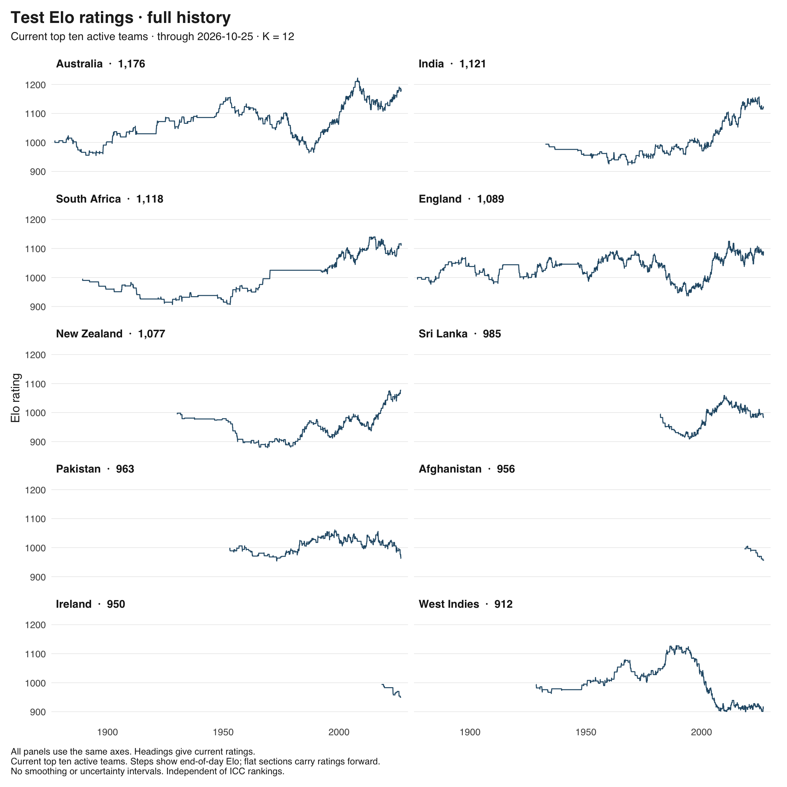

# ELO cricket ratings through 2026-10-25

Independent ratings of men's international teams. Results enter on their completion date.

[Latest ratings](latest.csv) · [Monthly history](monthly.csv) · [Match updates](updates.csv)

[Methods and limitations](../../../docs/pipeline.md#elo-specification)

## ODI

Most recent recorded result: 2026-10-25

K: 27

[Download recent-history SVG](odi.svg)

Full history by team

[Download full-history SVG](odi_history.svg)

### Current ratings

| Rank | Team | Rating | Rated matches | Last rated match |
| ---: | --- | ---: | ---: | --- |
| 1 | India | 1309 | 1040 | 2026-10-03 |
| 2 | New Zealand | 1275 | 814 | 2026-07-21 |
| 3 | Pakistan | 1246 | 984 | 2026-10-25 |
| 4 | Australia | 1225 | 996 | 2026-09-30 |
| 5 | South Africa | 1217 | 683 | 2026-09-30 |
| 6 | Afghanistan | 1170 | 185 | 2026-10-23 |
| 7 | Sri Lanka | 1165 | 908 | 2026-10-22 |
| 8 | England | 1152 | 801 | 2026-10-25 |
| 9 | West Indies | 1080 | 875 | 2026-10-03 |
| 10 | Bangladesh | 1076 | 459 | 2026-10-21 |
| 11 | Scotland | 1020 | 175 | 2026-08-13 |
| 12 | U.S.A. | 991 | 86 | 2026-10-13 |
| 13 | Netherlands | 957 | 148 | 2026-10-25 |
| 14 | Zimbabwe | 942 | 576 | 2026-10-23 |
| 15 | Namibia | 920 | 85 | 2026-10-24 |
| 16 | Nepal | 919 | 97 | 2026-10-19 |
| 17 | Ireland | 918 | 200 | 2026-10-24 |
| 18 | Oman | 842 | 76 | 2026-10-19 |
| 19 | U.A.E. | 796 | 140 | 2026-10-25 |
| 20 | Canada | 772 | 114 | 2026-10-17 |

## T20I

Most recent recorded result: 2026-10-25

K: 77

[Download recent-history SVG](t20i.svg)

Full history by team

[Download full-history SVG](t20i_history.svg)

### Current ratings

| Rank | Team | Rating | Rated matches | Last rated match |
| ---: | --- | ---: | ---: | --- |
| 1 | England | 1680 | 222 | 2026-09-19 |
| 2 | India | 1561 | 290 | 2026-10-24 |
| 3 | South Africa | 1502 | 232 | 2026-09-06 |
| 4 | Pakistan | 1456 | 296 | 2026-10-13 |
| 5 | West Indies | 1452 | 247 | 2026-10-14 |
| 6 | Australia | 1417 | 222 | 2026-06-21 |
| 7 | Nepal | 1380 | 120 | 2026-09-25 |
| 8 | Portugal | 1372 | 51 | 2026-08-21 |
| 9 | Ireland | 1347 | 181 | 2026-06-28 |
| 10 | New Zealand | 1344 | 257 | 2026-10-24 |
| 11 | Jersey | 1337 | 61 | 2026-05-23 |
| 12 | Spain | 1331 | 53 | 2026-08-21 |
| 13 | U.S.A. | 1322 | 56 | 2026-02-15 |
| 14 | Kenya | 1312 | 135 | 2026-09-19 |
| 15 | Sri Lanka | 1303 | 241 | 2026-10-13 |
| 16 | Uganda | 1300 | 129 | 2026-10-25 |
| 17 | Afghanistan | 1275 | 167 | 2026-09-25 |
| 18 | U.A.E. | 1247 | 151 | 2026-09-17 |
| 19 | Denmark | 1232 | 52 | 2026-07-14 |
| 20 | Zimbabwe | 1230 | 200 | 2026-09-06 |
| 21 | Namibia | 1228 | 98 | 2026-09-04 |
| 22 | Nigeria | 1218 | 103 | 2026-10-25 |
| 23 | Qatar | 1208 | 88 | 2026-10-14 |
| 24 | Bangladesh | 1204 | 217 | 2026-10-03 |
| 25 | Hong Kong | 1199 | 137 | 2026-10-14 |
| 26 | Bermuda | 1194 | 59 | 2026-09-27 |
| 27 | Tanzania | 1191 | 80 | 2026-03-28 |
| 28 | Germany | 1182 | 79 | 2026-08-21 |
| 29 | Italy | 1181 | 42 | 2026-02-19 |
| 30 | Netherlands | 1179 | 128 | 2026-02-18 |
| 31 | Saudi Arabia | 1171 | 71 | 2026-10-14 |
| 31 | Guernsey | 1171 | 53 | 2026-05-23 |
| 33 | Scotland | 1170 | 112 | 2026-04-18 |
| 34 | Canada | 1160 | 88 | 2026-02-19 |
| 35 | Belgium | 1149 | 66 | 2026-07-14 |
| 36 | Bahrain | 1139 | 132 | 2026-10-14 |
| 37 | Cayman | 1138 | 51 | 2026-09-27 |
| 38 | Sweden | 1130 | 56 | 2026-07-02 |
| 39 | France | 1124 | 53 | 2026-07-30 |
| 40 | Malaysia | 1118 | 134 | 2026-10-14 |
| 41 | Japan | 1096 | 63 | 2026-09-24 |
| 42 | Kuwait | 1090 | 87 | 2026-10-12 |
| 42 | Romania | 1090 | 80 | 2026-07-30 |
| 44 | P.N.G. | 1080 | 73 | 2026-05-18 |
| 45 | Rwanda | 1062 | 138 | 2026-09-17 |
| 46 | Argentina | 1052 | 36 | 2026-03-15 |
| 47 | Oman | 1049 | 119 | 2026-09-25 |
| 48 | Finland | 1046 | 55 | 2026-08-21 |
| 49 | Austria | 1042 | 105 | 2026-07-30 |
| 50 | Switzerland | 990 | 42 | 2026-06-21 |
| 51 | Isle of Man | 972 | 30 | 2026-08-21 |
| 52 | Malta | 970 | 93 | 2026-05-23 |
| 53 | Singapore | 959 | 84 | 2026-10-14 |
| 54 | Cook Islands | 948 | 23 | 2026-05-18 |
| 55 | Malawi | 946 | 72 | 2026-08-16 |
| 56 | Samoa | 944 | 37 | 2026-05-18 |
| 57 | Norway | 942 | 63 | 2026-07-14 |
| 58 | Brazil | 938 | 29 | 2026-08-09 |
| 58 | South Korea | 938 | 28 | 2026-10-05 |
| 60 | Czech Rep. | 936 | 58 | 2026-08-21 |
| 61 | Zambia | 928 | 21 | 2026-10-25 |
| 62 | Philippines | 922 | 47 | 2026-05-18 |
| 63 | Panama | 915 | 35 | 2026-08-09 |
| 64 | Botswana | 912 | 76 | 2026-09-18 |
| 65 | Eswatini | 906 | 46 | 2026-06-07 |
| 66 | Turks and C. (provisional) | 885 | 4 | 2025-04-20 |
| 67 | Falkland Isl (provisional) | 865 | 6 | 2025-03-13 |
| 68 | Mozambique | 862 | 53 | 2026-10-25 |
| 69 | Hungary | 858 | 57 | 2026-07-14 |
| 70 | Cyprus | 857 | 42 | 2026-05-22 |
| 71 | Mexico | 856 | 43 | 2026-08-08 |
| 72 | Israel | 853 | 18 | 2026-08-21 |
| 73 | Thailand | 846 | 73 | 2026-10-14 |
| 74 | Peru (provisional) | 844 | 7 | 2026-08-08 |
| 75 | Ghana | 833 | 55 | 2026-09-26 |
| 76 | Belize | 827 | 20 | 2026-06-27 |
| 77 | Suriname | 822 | 14 | 2026-03-15 |
| 78 | Bahamas | 816 | 41 | 2026-09-26 |
| 79 | Cameroon | 804 | 27 | 2026-05-29 |
| 80 | Vanuatu | 801 | 46 | 2026-05-17 |
| 80 | Uzbekistan (provisional) | 801 | 4 | 2026-06-26 |
| 82 | Sierra Leone | 800 | 65 | 2026-09-27 |
| 83 | Estonia | 796 | 39 | 2026-07-14 |
| 84 | Bhutan | 779 | 52 | 2026-10-14 |
| 85 | Maldives | 763 | 53 | 2026-10-14 |
| 86 | Croatia | 761 | 36 | 2026-05-23 |
| 87 | Luxembourg | 760 | 60 | 2026-08-20 |
| 88 | Seychelles | 752 | 19 | 2026-03-28 |
| 89 | St Helena | 751 | 14 | 2026-03-28 |
| 90 | Gibraltar | 750 | 61 | 2026-07-14 |
| 91 | Costa Rica | 739 | 22 | 2026-04-04 |
| 92 | Bulgaria | 738 | 68 | 2026-08-21 |
| 93 | Indonesia | 735 | 117 | 2026-10-05 |
| 94 | Fiji | 729 | 22 | 2026-05-18 |
| 95 | Cambodia | 720 | 43 | 2025-12-29 |
| 96 | Gambia | 719 | 17 | 2026-10-25 |
| 97 | Greece | 708 | 18 | 2026-08-20 |
| 98 | China | 696 | 18 | 2026-10-14 |
| 99 | Turkey | 665 | 28 | 2026-07-29 |
| 100 | Timor-Leste (provisional) | 651 | 8 | 2025-11-14 |
| 101 | Ivory Coast | 646 | 11 | 2026-05-30 |
| 102 | Slovenia | 636 | 24 | 2026-05-22 |
| 103 | Lesotho | 629 | 38 | 2026-10-25 |
| 104 | Mali | 607 | 19 | 2026-05-30 |
| 105 | Serbia | 605 | 52 | 2026-07-14 |
| 106 | Myanmar | 595 | 38 | 2026-10-14 |
| 107 | Mongolia | 554 | 19 | 2026-10-14 |

## Test

Most recent recorded result: 2026-10-22

K: 12

[Download recent-history SVG](test.svg)

Full history by team

[Download full-history SVG](test_history.svg)

### Current ratings

| Rank | Team | Rating | Rated matches | Last rated match |
| ---: | --- | ---: | ---: | --- |
| 1 | Australia | 1176 | 886 | 2026-10-22 |
| 2 | India | 1121 | 601 | 2026-08-27 |
| 3 | South Africa | 1118 | 481 | 2026-10-22 |
| 4 | England | 1089 | 1100 | 2026-09-12 |
| 5 | New Zealand | 1077 | 487 | 2026-06-29 |
| 6 | Sri Lanka | 985 | 331 | 2026-08-27 |
| 7 | Pakistan | 963 | 474 | 2026-09-12 |
| 8 | Afghanistan | 956 | 14 | 2026-10-13 |
| 9 | Ireland | 950 | 13 | 2026-05-29 |
| 10 | West Indies | 912 | 596 | 2026-08-05 |
| 11 | Bangladesh | 871 | 162 | 2026-10-13 |
| 12 | Zimbabwe | 785 | 130 | 2026-06-30 |
